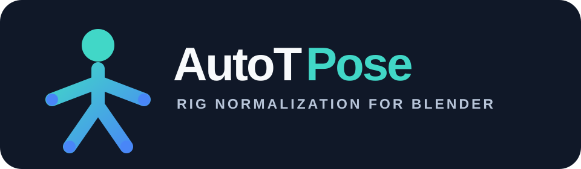

# AutoTPose

<p align="center">
  
</p>

**Automatic T-pose normalization for humanoid 3D rigs in Blender.**

AutoTPose is an open-source Blender Python utility that attempts to detect a
humanoid character's upper arms and forearms, then aligns them into a clean
T-pose for animation, retargeting, and export workflows.

Created by [4ON Studios](https://www.4onstudios.com/).

## Features

- Detects an armature from the selected mesh or armature.
- Recognizes common Mixamo, Rigify, Unreal-style, and custom bone naming patterns.
- Falls back to hierarchy and geometry heuristics when bone names are unusual.
- Aligns upper arms using the rig's shoulder-to-shoulder axis instead of assuming a fixed world axis.
- Optionally straightens forearms.
- Can keep the result as a pose or apply it as the new rest pose.
- Does not require hard-coded 90-degree rotations.
- Provides a headless command interface with machine-readable reports for agent
  and pipeline use.
- Uses the project-local `instance-rig` auto-rig backend as the primary rigging
  path when it is available, while keeping the native Blender rigger as a
  compatibility fallback only.
- Keeps a Blender-independent solver contract ready for a future compiled core.

## Requirements

- Blender with Python scripting support.
- A **rigged humanoid model** with an armature.

AutoTPose does **not** automatically rig a completely unrigged mesh.

For automated processing, it accepts rigged `.blend`, `.glb`, and `.gltf`
inputs and writes a T-posed `.blend` or `.glb` file. For an unrigged, upright
humanoid, `make rig-pose` can create a basic armature and Blender automatic
weights before posing. Use `make rig-pose-rest` when the exported GLB must have
the T-pose baked as its rest pose; review the generated weights before production
use.

## Quick Start

1. Import your humanoid FBX, GLB, or other supported model into Blender.
2. Select the character mesh or armature.
3. Open **Scripting > Text Editor**.
4. Open `auto_t_pose.py`.
5. Click **Run Script**.
6. Check the Blender console for detected arm and forearm bones.

By default, AutoTPose creates the T-pose without changing the rig's rest pose.

To bake the result as the new rest pose, either set the module flag:

```python
APPLY_AS_REST_POSE = True
```

or call the script-level function explicitly:

```python
make_t_pose(auto_rig=True, bind_method="DISTANCE", apply_rest_pose=True)
```

This is useful when you want the exported GLB to keep the corrected T-pose as
its bind/rest pose instead of only posing the rig in-place.

> Applying a new rest pose changes the rig and can affect existing animations.
> Work on a copy of important files.

## Configuration

The main options are at the top of `auto_t_pose.py`:

```python
APPLY_AS_REST_POSE = False
RESET_POSE_FIRST = True
STRAIGHTEN_FOREARMS = True
MUTE_CONSTRAINTS = False
RESTORE_CONSTRAINTS = True
VERBOSE = True
```

## Detection Strategy

AutoTPose uses two stages:

1. **Name-based detection** for common upper-arm and forearm naming conventions.
2. **Geometry/hierarchy fallback** that examines deform bones, limb proportions,
   mirrored shoulder placement, ancestry, and outward bone direction.

This makes it more tolerant of custom rigs than scripts that rely on exact bone names.

## Repository Layout

```text
AutoTPose/
├── auto_t_pose.py              # standalone Blender script
├── src/autotpose_core/         # Blender-neutral contracts for future solvers
├── tests/                       # tests that run without Blender
├── docs/ARCHITECTURE.md         # code boundaries and design rules
├── docs/COMPILED_CORE.md        # conditions/plan for an optional compiled core
├── CONTRIBUTING.md
├── CHANGELOG.md
├── LICENSE
└── pyproject.toml
```

### Compiled-core readiness

A compiled implementation would currently add packaging and build complexity
without addressing the main challenge: correct skeleton detection. AutoTPose
therefore remains Python-first. The core contract is separated now so a future
compiled solver can be introduced without coupling it to Blender's `bpy` API.

See [Architecture](docs/ARCHITECTURE.md) and [Compiled Core Plan](docs/COMPILED_CORE.md).

## Current Limitations

- Intended for humanoid rigs.
- It does not create an armature or skin an unrigged mesh.
- Unusual control rigs, constraints, helper bones, or non-human proportions can confuse automatic detection.
- Hand/palm orientation and bone roll are preserved as much as possible but are not normalized to a specific engine standard.
- Existing animation may require retargeting if you apply the generated pose as a new rest pose.

## Roadmap

Potential future additions:

- One-click Blender add-on UI.
- Automatic A-pose and rest-pose normalization.
- Better hand and palm orientation.
- Skeleton profiles for Mixamo, Unreal, Unity, Rigify, VRM, and other common rigs.
- Batch processing for FBX/GLB character libraries.
- Automatic export after normalization.
- Blender-neutral pose solver with benchmarks.
- Optional compiled acceleration only if profiling or cross-host reuse justifies it.

## Development

The standalone Blender script does not require installing the `src` package.
Use [uv](https://docs.astral.sh/uv/) to create the project-local Python 3.11
environment and run the Blender-neutral core-contract tests:

```bash
make sync
make test
```

The repository keeps `instance-rig` and its TensorFlow/MediaPipe stack confined
to the project-local environment and treats it as the preferred auto-rigging
path by default. The native Blender rigger remains available as a compatibility
fallback when the local backend is unavailable or fails on a particular mesh.
The project venv uses Python 3.11 because the current `instance-rig` dependency
chain is compatible with that runtime on macOS; Blender's embedded Python is 3.13,
so the library is invoked through a subprocess rather than imported directly
inside Blender.

Run `make help` to list the available development commands.

## Automated and Agent Use

For repeatable, non-interactive `.blend` processing, use `make pose`. It writes
a separate output file and a JSON result report, allowing an agent or pipeline
to validate the outcome. See [the agent tool contract](AGENTS.md) for the
required inputs, result format, and explicit rest-pose behavior.

## App-ready headless workflow

AutoTPose is designed to be called from an application or pipeline, not from a
browser-only extension. The repo's primary interface is the local Blender CLI:

```bash
make rig-pose-rest \
  BLENDER="/Applications/Blender.app/Contents/MacOS/Blender" \
  INPUT="/absolute/path/to/model.glb" \
  OUTPUT="/absolute/path/to/model_tpose.glb" \
  REPORT="/absolute/path/to/model_tpose-report.json"
```

This produces a GLB with the corrected T-pose baked into the rig's rest pose,
which is the configuration most downstream apps want before animation,
retargeting, or model processing.

The browser bridge under `mesh2motion-extension/` remains a legacy prototype only
and is intentionally not the recommended integration path for this project.

## Contributing

Issues, test rigs, bug reports, and pull requests are welcome. If a particular
skeleton is detected incorrectly, include the Blender version and the relevant
bone names/hierarchy when possible.

See [CONTRIBUTING.md](CONTRIBUTING.md).

## License

AutoTPose is released under the [MIT License](LICENSE).

Copyright © 2026 4ON Studios.

## Website

[4ON Studios](https://www.4onstudios.com/)
